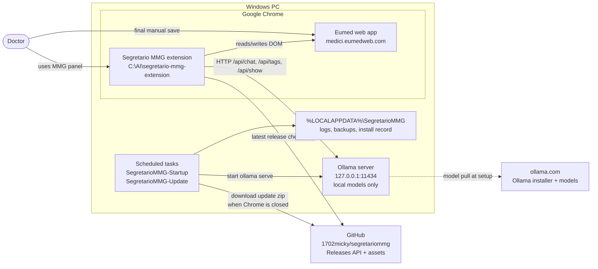
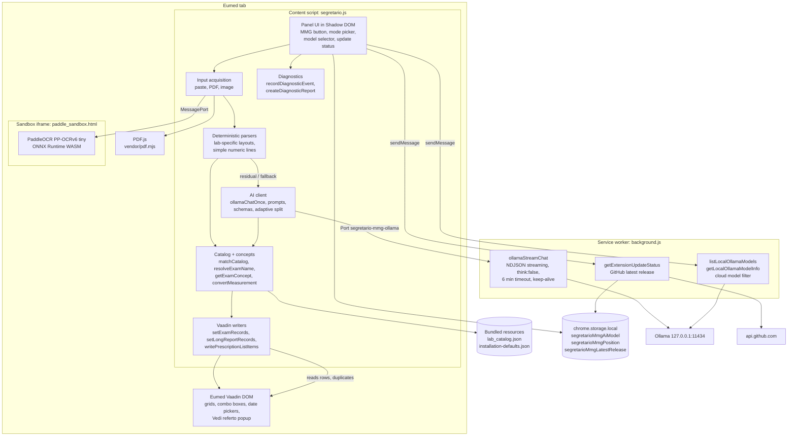
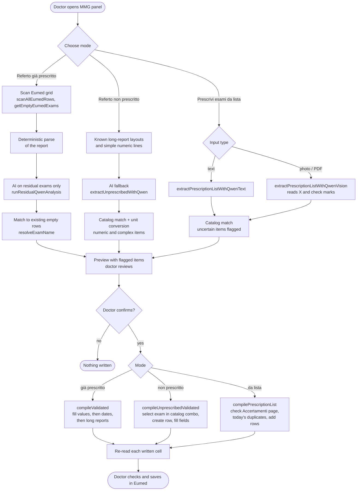
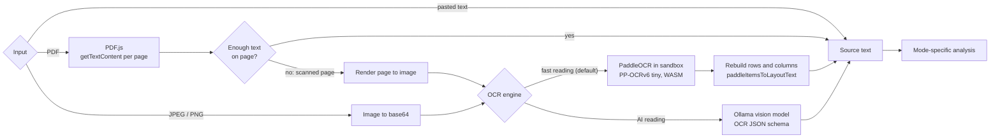
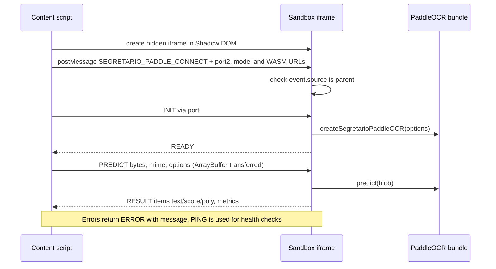
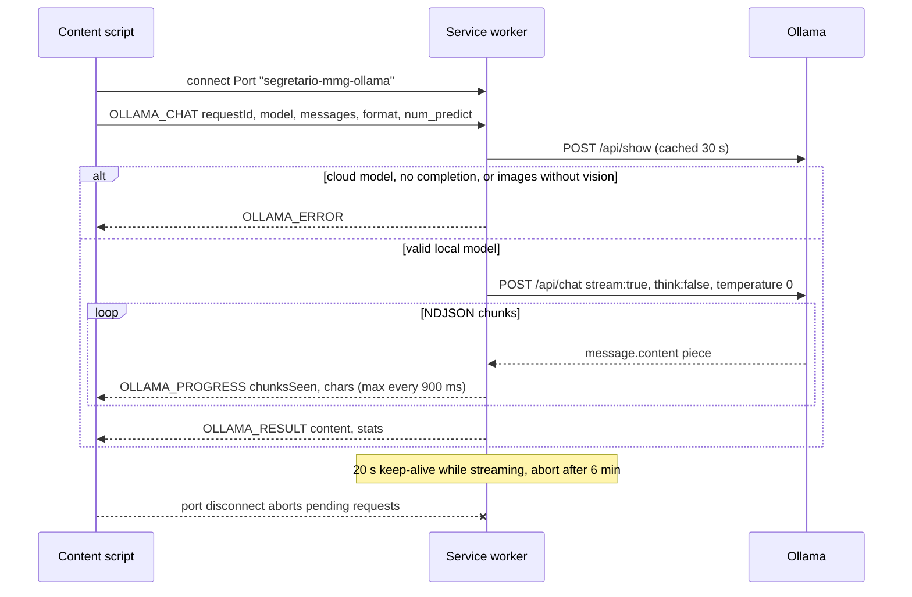
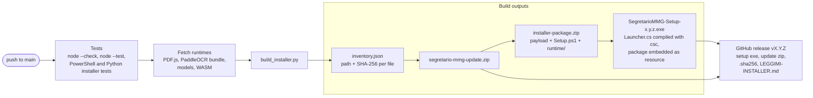
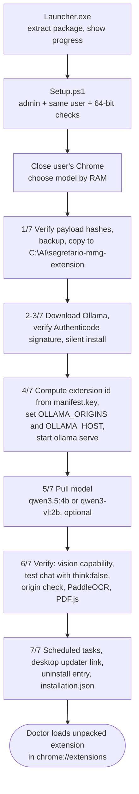
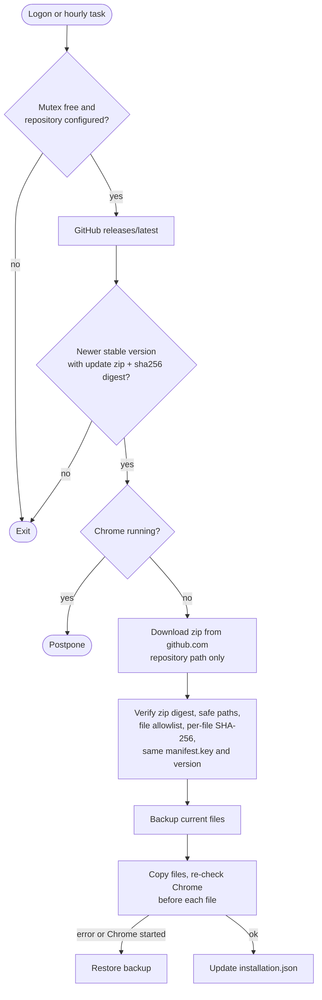

# Segretario MMG – Architecture

This document describes how Segretario MMG is built: the Chrome extension that runs inside Eumed, the local AI and OCR engines it uses, and the Windows installer/updater that deploys it. For build and test commands see [SVILUPPO.md](SVILUPPO.md).

## 1. System context

Segretario MMG is a Chrome Manifest V3 extension injected into `https://medici.eumedweb.com/*`. It reads lab reports or exam lists (pasted text, PDF, JPEG, PNG), interprets them deterministically or with a local LLM, matches the exams against a bundled lab catalog and fills the Eumed (Vaadin) forms row by row. The final save in Eumed is always left to the doctor.

All AI inference runs on the local machine through Ollama on `127.0.0.1:11434`. Cloud models are filtered out. The only Internet endpoint used by the extension is the public GitHub Releases API, for the update check, and it never receives patient data.

## 2. Extension components

The extension has three runtime contexts, isolated by Chrome:

- **Content script** – [segretario.js](../segretario.js). Runs inside the Eumed page. It contains the whole application: UI panel (in a Shadow DOM), parsing, catalog matching, unit conversion, prompts, Vaadin automation and diagnostics. It cannot call Ollama directly, so AI requests are proxied through the service worker.
- **Service worker** – [background.js](../background.js). Holds the extension host permissions. It streams chat requests to Ollama, lists and inspects local models, checks GitHub for updates and toggles the panel when the toolbar icon is clicked.
- **OCR sandbox** – [paddle_sandbox.html](../paddle_sandbox.html) + [paddle_sandbox.js](../paddle_sandbox.js). A sandboxed extension page, loaded as a hidden iframe in the panel Shadow DOM. Its CSP allows `wasm-unsafe-eval`, which PaddleOCR (ONNX Runtime WASM) needs and which the Eumed page context does not allow.

Static resources are exposed through `web_accessible_resources` in [manifest.json](../manifest.json): `lab_catalog.json`, `installation-defaults.json`, PDF.js (`vendor/pdf.mjs`, `vendor/pdf.worker.mjs`) and the PaddleOCR bundle, models and WASM files under `vendor/paddleocr/`.

### Main content-script areas

| Area | Responsibility | Key functions |
|---|---|---|
| Configuration | Constants, preferred units, PDF/OCR limits | `CONFIG` |
| Exam concepts | Maps lab wording to canonical concepts and long-report kinds | `getExamConcept`, `getLongReportKind` |
| Eumed grid reader | Indexes existing grid rows and finds empty prescribed rows | `scanAllEumedRows`, `getEmptyEumedExams` |
| Lab catalog | Loads `lab_catalog.json`, ranks candidates by name, alias and specimen | `matchCatalog`, `resolveExamName` |
| Numeric writer | Writes date, value, min, max and re-reads each cell | `setExamRecords`, `setExamRecord`, `setExamField` |
| Long-report writer | Opens "Vedi referto", writes text, closes and verifies | `setLongReportRecords`, `writeLongReportText` |
| Unit conversion | Deterministic conversion of values and ranges | `convertMeasurement`, `convertRange` |
| AI client | Chunking, prompts, JSON schemas, port calls | `splitTextAdaptive`, `ollamaChatOnce`, `extractReportChunk` |
| Deterministic parsers | Lab-specific layouts and simple "name value unit" lines | `extractSimpleNumericReport`, `extractPaddleTabularResults` |
| OCR pipeline | PDF text layer, page rendering, PaddleOCR or vision-model OCR | `extractTextFromPdfFile`, `extractTextFromImageFile`, `createPaddleSandboxClient` |
| Workflows | One analyze/compile pair per mode | `analyzeReport`/`compileValidated`, `analyzeUnprescribedReport`/`compileUnprescribedValidated`, `analyzePrescriptionList`/`compilePrescriptionList` |
| Diagnostics | Content-free event log and downloadable `.txt` report | `recordDiagnosticEvent`, `createDiagnosticReport` |

## 3. Workflow modes

The panel offers three modes (`WORKFLOW_MODE`). Each mode has an **analyze** step that produces a preview for the doctor, and a **compile** step that writes to Eumed only after the doctor confirms.

Notes on the modes:

- **Referto già prescritto** fills only rows already present in "Inserimento da prescrizioni". Exams recognised with certainty but without a row are offered as a copyable block for the "non prescritto" mode, which re-validates it without AI.
- **Referto non prescritto** can skip AI entirely when every line is a simple, unambiguous "name value unit" line. Urine, 24-hour collections and composite reports (e.g. blood count) are written as long reports.
- **Prescrivi esami da lista** treats a row as a duplicate only when its "Data presc." is today. Unreadable dates require explicit confirmation.

## 4. Input and OCR pipeline

PDF files are read with PDF.js first. Pages with less than `CONFIG.pdfTextPageMinChars` useful characters are treated as scans and rendered to images (max `CONFIG.pdfVisionMaxPages`). Scanned pages and image files go to PaddleOCR by default, or to the selected vision model when the doctor chooses AI reading.

The sandbox handshake uses a dedicated `MessageChannel`, because the sandbox has an opaque origin:

## 5. AI request path

The content script opens a long-lived `chrome.runtime` Port named `segretario-mmg-ollama` for each request. The service worker validates the model, then streams the Ollama NDJSON response and forwards progress. Closing the port aborts the request.

Model metadata and update status use one-shot `chrome.runtime.sendMessage` calls:

| Message | Sender → receiver | Purpose |
|---|---|---|
| `OLLAMA_LIST_MODELS` | content script → service worker | Local models from `/api/tags`, cloud models removed |
| `OLLAMA_MODEL_INFO` | content script → service worker | `completion` and `vision` capabilities from `/api/show` |
| `SEGRETARIO_CHECK_UPDATE` | content script → service worker | Compare manifest version with the latest stable GitHub release |
| `SEGRETARIO_MMG_TOGGLE` | service worker → content script | Toolbar icon click opens or closes the panel |

The service worker accepts these messages only from its own extension id (`sender.id === chrome.runtime.id`).

## 6. Data and configuration

| Item | Location | Notes |
|---|---|---|
| Lab catalog | [lab_catalog.json](../lab_catalog.json) | Eumed exam names, codes, aliases, specimens. Maintained with [tools/reconcile_lab_catalog.py](../tools/reconcile_lab_catalog.py) from a regional workbook (read only). |
| Default model | `installation-defaults.json` | Written by the setup with the model chosen at install time. |
| User preferences | `chrome.storage.local` | Selected model, panel position, cached release status. |
| Extension identity | `manifest.key` | Fixes the extension id, used for `OLLAMA_ORIGINS`. Must not change. |
| Install state | `%LOCALAPPDATA%\SegretarioMMG` | `setup.log`, `update.log`, `installation.json`, backups, previous Ollama environment. |

Patient data is held only in page memory during a session. Diagnostics record timings, counts and states, not report content.

## 7. Build, release and deployment

A push to `main` runs [.github/workflows/release.yml](../.github/workflows/release.yml) on Windows. It runs the tests, downloads PDF.js and PaddleOCR, builds the installer with [tools/build_installer.py](../tools/build_installer.py) and creates release `v<manifest.version>` if it does not exist yet.

### Installation

The setup EXE is a small WinForms launcher ([installer/Launcher.cs](../installer/Launcher.cs)) that extracts the embedded package and runs [installer/Setup.ps1](../installer/Setup.ps1) elevated, showing progress from a JSON file the script updates.

### Automatic updates

Two update paths exist and complement each other:

- **In the panel**: the service worker checks the latest GitHub release and offers the setup EXE download. Downloading does not install anything.
- **Scheduled task**: [installer/runtime/Update.ps1](../installer/runtime/Update.ps1) runs at logon (via `Startup.ps1`, which also starts Ollama) and every hour. It replaces extension files only while Chrome is fully closed.

Uninstall ([installer/runtime/Uninstall.ps1](../installer/runtime/Uninstall.ps1)) removes only files listed in `installation.json`, the scheduled tasks and shortcuts, and restores the previous Ollama environment variables. Ollama and models stay installed.

## 8. Safety and privacy design

- **Local-only AI**: requests go to `127.0.0.1:11434`. Models with `:cloud`, `-cloud`, `remote_host` or `remote_model` are rejected.
- **Deterministic first**: parsers and catalog rules run before AI. AI output is checked against the source text and the catalog; uncertain items are flagged, not written.
- **`think: false`, `temperature: 0`** on every chat request.
- **Human in the loop**: nothing is written before the preview is confirmed. Global save and prescription submission are never pressed.
- **Write verification**: each Vaadin cell is re-read after writing.
- **Duplicate guard** in list prescription: based on today's "Data presc." only.
- **Narrow permissions**: `storage`, host access only to local Ollama and the GitHub API, content script only on Eumed.
- **Update integrity**: GitHub digest, per-file hashes, path allowlist, unchanged `manifest.key`, backup and rollback.
- **No patient data in diagnostics, logs, update checks or the repository.**
